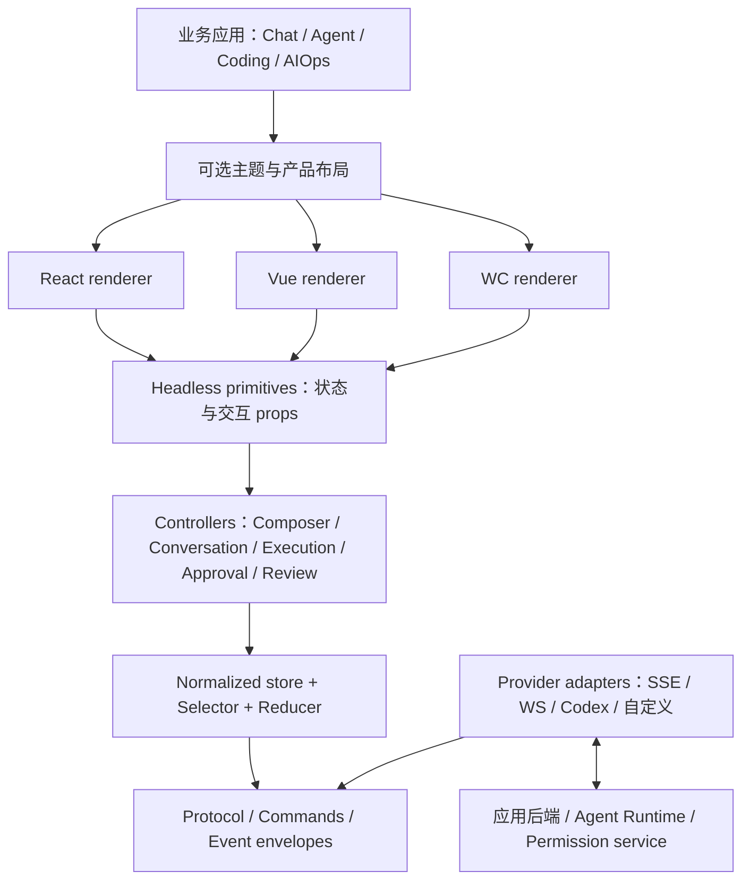
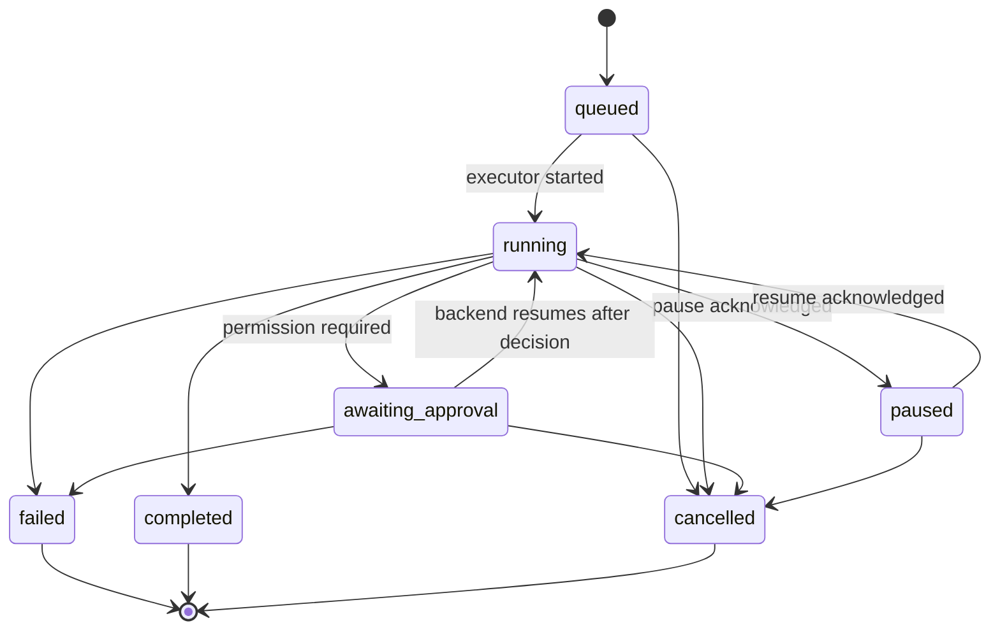
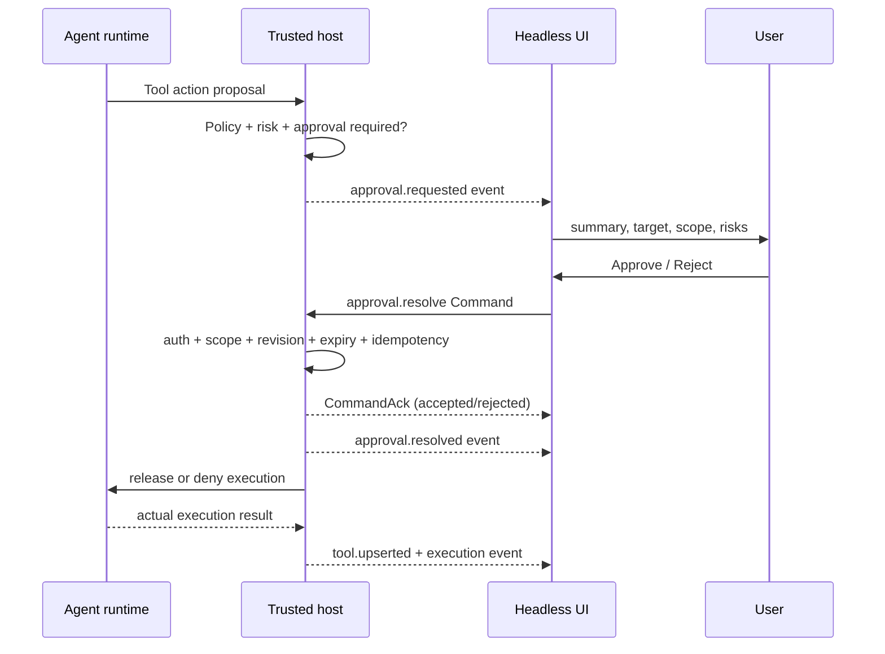

# Zeus AI Headless V2 — 从零设计的交互体系

> 状态：RFC / Proposed（不宣称已有实现）  
> 日期：2026-10-16  
> 适用：ChatGPT 类 AI 会话、Codex 类 Coding Agent、研究助手、运维智能体及可嵌入式 AI 工作台  
> 维护方向：Zeus / Zeus UI；旧 `@zeus-web/chat` 与 `@zeus-web/agent-console` 仅作为可迁移资产，不是 V2 的设计约束。

## 0. 结论摘要

V2 的基本公式：**领域模型（Domain） → 交互控制器（Headless Controller） → 语义原语（Primitive） → 目标框架渲染器（WC / React / Vue）**。底层编译器、响应式实现和 UI 样式不是产品领域模型的一部分。

这不是“Chat + AgentConsole v2”，也不是“所有 AI 内容统一成 MessagePart”。需要独立表示：

- **Conversation**：用户和 AI 如何交流，消息和分支如何组织；
- **Execution**：模型或 Agent 一次可取消、可恢复的执行，工具和计划如何推进；
- **Artifact / ChangeSet**：AI 产出的文件、报告、代码改动，如何预览、审核、采纳；
- **Approval**：高风险操作和外部副作用的授权；
- **Composer / Context**：用户草稿、附件、模型和工作区上下文；
- **Activity projection**：给用户看的混合时间线，属于**投影**，不作为所有内容共同的数据库根实体。

不要强行套用 ChatGPT 或 Codex 内部私有协议。它们是**交互参考**，V2 契约独立且提供 adapter。

## 1. 重新设计的原因：与 V1 的根本分歧

| V1 假设 | V2 决策 | 论证 |
|---|---|---|
| `Chat` 和 `AgentConsole` 是两个主组件 | 没有强制主组件；由能力与场景组合 | 产品可同时包含聊天和多执行任务 |
| Message / Tool / Artifact 塞进一个通用数据对象 | 领域对象各自独立，用引用关联 | 不同聚合有独立生命周期、版本和权限 |
| 单一 Agent 事件数组即全部状态 | 规范化实体 + 领域事件 + 衍生时间线 | 避免反复克隆列表、全量重渲染及语义混乱 |
| WC 是唯一真正的渲染底层 | TS Controller 是共享底层；WC、React、Vue 各有渲染器 | React 节点和 Vue VNode 无法天然由 WC 解释 |
| UI 组件直接调用 Agent Provider | UI 只发送 Command；Adapter/Host 控制执行 | 审批、安全与副作用不能交给浏览器组件 |
| 所有 UI 元素都有 ChatGPT/Codex 式固定外观 | Headless 负责行为、语义、可访问性；Skin 是可选包 | 适配不同设计系统、业务产品和原生 WC |
| 先做几十个组件 | 先跑通 3 个用户故事和底层协议 | 更易验证真正可复用性 |

### 1.1 非目标

- 不创建 LLM、Agent Loop、MCP Runtime、沙箱、Git 执行器、文件存储服务。
- 不实现一个完整 IDE、终端模拟器或 Markdown 编辑器。
- 不把 OpenAI 私有的产品特性或数据格式当作跨服务标准。
- 不要求页面必须长得像 ChatGPT 或 Codex；只复用经过验证的交互模式。
- 不保证所有 React/Vue 组件内容都能透过普通 WC slot 无损传递。

## 2. 产品与用户故事

### 2.1 四种产品表面（Surface），同一套核心

| Surface | 最重要的用户目标 | 重要交互 | 不属于核心的外观选择 |
|---|---|---|---|
| Conversation | 快速发问、理解答案、继续对话 | Composer、流式答案、来源、附件、分支、编辑重试 | 左侧历史栏是否常驻、气泡样式 |
| Agent Task | 将目标交给工具执行并控制风险 | 执行状态、计划、工具明细、审批、中断/恢复 | 进度图标和步骤卡片的样式 |
| Coding Workspace | 对运行产物进行有依据的审查 | 仓库/工作树、变更清单、Diff、测试、评论、采纳 | IDE 三栏布局是否模仿 Codex |
| Embedded Copilot | 把 AI 放入已有业务系统 | 上下文选择、对话、引用、动作确认、侧边抽屉 | 抽屉宽度、颜色、悬浮按钮 |

### 2.2 必须贯通的三条端到端故事

**S1 · Conversational Research：** 编辑输入 → 选择模型/上下文 → 添加附件 → 发送（返回接受确认） → 流式回答 → 查看引用与产物 → 停止/重新生成 → 编辑早期消息后创建分支；滚动时阅读位置不被流打断。

**S2 · Agent Supervision：** 创建任务 → 排队 → 计划生成/修改 → 运行工具 → 请求敏感操作审批 → 用户审阅参数与权限范围 → 批准/拒绝 → 任务继续、失败或取消 → 展示可追溯结果。

**S3 · Coding Review：** 指定项目、工作树和任务 → 并行任务执行 → 分别查看进度 → 比较文件变更 → 按文件/片段评论 → 查看测试 → 明确采纳/丢弃操作 → 服务端返回执行结果；不直接在浏览器由 Diff 组件写磁盘。

### 2.3 界面参考的抽象，不复制产品实现

- ChatGPT：持续对话、底部 Composer、模型/模式上下文、工具结果与附件作为独立内容、长回复友好阅读。
- Codex：面向任务的工作区、多任务并行、执行/审批进度、独立工作树、Diff Review、代码变更回馈。
- 两者共同点：AI 在处理信息与执行操作时，必须提供**可理解、可中断、可恢复、可审查**的交互。

参考：
- OpenAI, *Introducing the Codex app*（2026-02-02，2026-03-04 更新）：https://openai.com/index/introducing-the-codex-app/
- OpenAI Developers, *Codex as a platform*（2026-08-19）：https://developers.openai.com/blog/codex-as-a-platform
- OpenAI, *DevDay 2026 Recap*：https://openai.com/index/devday-2026-recap/
- W3C APG Combobox / Dialog / Treeview： https://www.w3.org/WAI/ARIA/apg/patterns/

## 3. 关键架构决策

### 3.1 分层边界



**硬性约束：** `core` 和 `primitives` 在 Node.js 环境 `import` 时不得读取 `window`、`document` 或 `HTMLElement`。React/Vue 不依赖 WC 包；WC 包不得依赖 React/Vue。

### 3.2 共享的是协议与控制器，不一定是 DOM

- 共享：Domain Types、Reducer、Selector、Command API、Keyboard Intent、Focus/Selection Model、State Machines。
- 不共享：React Element/Vue VNode 渲染过程、DOM Portal 实现、虚拟化测量机制、编辑器/终端/预览器挂载策略。
- 可选 WC Render：基础聊天、Composer、审批面板、常规 Diff 文本模式。
- 原生 React/Vue Render：嵌入复杂任意框架内容（如 React 自定义 Cell、MDX、Monaco）时保留框架语义。

### 3.3 Command 与 Event 分离（CQRS-lite）

UI 的 `send` / `approve` / `applyChanges` 是**意图**，不是事实。UI 只能下发 Command，服务端受理并返回结果后，Store 才更新相应事实状态。可做清晰标注的 optimistic projection，但服务端事实必须优先。

### 3.4 单向数据流

`ProviderEvent → validate → normalize → dedupe/order → reduce → selector → controller → renderer`

反向：`UserIntent → Command → host adapter → command ack / domain event → state`。

Renderer 不把 DOM 修改直接回写为领域数据；DOM local state（焦点/展开/尺寸）是独立临时 UI 状态。

## 4. 包的分层与职责

拟议目录（尚未创建）：

```text
packages/ai-v2/
  protocol/        # 事件信封、命令、协议版本、校验器
  core/            # 领域实体、规范化 Store、Reducer、Selectors
  controllers/     # Composer、Conversation、Execution、Approval、Review
  primitives/      # 无样式交互契约、slots、a11y/keyboard intents
  wc/              # defineElement wrappers / registration / light/shadow options
  react/           # React hooks + compound component adapters
  vue/             # composables + slots component adapters
  adapters/        # SSE/WS/custom protocol bridge; no vendor lock-in
  testing/         # fake transport、fixture、replay、contract harness
  themes/          # 可选：Chat/Codex 风格皮肤，不属于 Headless
examples/
  ai-conversation/
  ai-agent-workbench/
  ai-coding-review/
  ai-embedded-copilot/
```

发布建议：`@zeus-web/ai-core`、`@zeus-web/ai-primitives`、`@zeus-web/ai-wc`、`@zeus-web/ai-react`、`@zeus-web/ai-vue`、`@zeus-web/ai-adapters`、`@zeus-web/ai-testing`。包名为**规划名**，发布前检查 npm 可用性及版本策略。

职责规则：

| 包 | 可以依赖 | 禁止依赖 |
|---|---|---|
| `ai-core` | TypeScript 标准库、轻量可移植工具 | React/Vue/WC/DOM/网络 SDK |
| `ai-primitives` | ai-core、浏览器无关的 a11y 模型 | 任何单一 UI Framework |
| `ai-wc` | ai-core、primitives、Zeus WC Runtime | React / Vue |
| `ai-react` | ai-core、primitives、React | ai-wc 作为必要运行时 |
| `ai-vue` | ai-core、primitives、Vue | ai-wc 作为必要运行时 |
| `ai-adapters` | ai-core、具体可选传输/供应商 SDK | DOM/UI |
| `ai-themes` | CSS Tokens / 视觉样式 | Agent Runtime / 业务后端 |

## 5. 领域模型：不要制造一个万能 Message

### 5.1 统一 ID 与实体规则

- 每个实体有稳定 `id`；租户/项目作用域由 host 明确校验，不从 ID 推断权限。
- 领域对象内部有单调递增 `revision`，时间戳仅用于显示而非排序保证。
- `Conversation` 与 `Execution` 是平级对象，互相**可选**关联。
- `ActivityItem` 是从事件和实体推导的 UI ViewModel；可以丢弃并重建。
- 大对象（图像、文件、Diff blob、工具输出）通过 `AssetRef` 引用，不塞入全量 Snapshot。

```ts
export type EntityId = string;
export type Timestamp = string; // ISO-8601 from authoritative source

export interface Project {
  id: EntityId;
  title: string;
  workspaceIds: EntityId[];
}

export interface Workspace {
  id: EntityId;
  projectId?: EntityId;
  kind: 'none' | 'local' | 'worktree' | 'remote';
  displayName: string;
  repo?: { id: string; ref?: string; revision?: string };
  capabilities: string[];
}

export interface Conversation {
  id: EntityId;
  projectId?: EntityId;
  title: string;
  selectedLeafMessageId?: EntityId;
  revision: number;
}

export type ContentPart =
  | { id: string; kind: 'text'; revision: number; text: string; format: 'plain' | 'markdown' }
  | { id: string; kind: 'image'; asset: AssetRef; alt?: string }
  | { id: string; kind: 'file'; asset: AssetRef; name: string }
  | { id: string; kind: 'reference'; sourceId: string; label?: string }
  | { id: string; kind: 'artifact-ref'; artifactId: string }
  | { id: string; kind: 'structured'; schema: string; value: unknown };

export interface Message {
  id: EntityId;
  conversationId: EntityId;
  parentMessageId?: EntityId; // 编辑/重试分支由边关系表达
  author: 'user' | 'assistant' | 'system' | 'tool';
  parts: ContentPart[];
  executionId?: EntityId; // AI 回答对应的执行，可缺省
  status: 'pending' | 'streaming' | 'complete' | 'failed' | 'cancelled';
  revision: number;
  createdAt: Timestamp;
}

export interface Execution {
  id: EntityId;
  kind: 'generation' | 'agent';
  conversationId?: EntityId;
  workspaceId?: EntityId;
  status: ExecutionStatus;
  createdAt: Timestamp;
  revision: number;
  activeStepIds: EntityId[];
  outcome?: { summary?: string; artifactIds?: EntityId[] };
}

export type ExecutionStatus =
  | 'queued' | 'running' | 'awaiting-approval' | 'paused'
  | 'completed' | 'failed' | 'cancelled';

export interface ExecutionStep {
  id: EntityId;
  executionId: EntityId;
  parentStepId?: EntityId;
  kind: 'plan' | 'tool' | 'reasoning-summary' | 'test' | 'output' | 'custom';
  status: 'pending' | 'running' | 'completed' | 'failed' | 'cancelled';
  label: string;
  startedAt?: Timestamp;
  completedAt?: Timestamp;
  toolInvocationId?: EntityId;
}

export interface ToolInvocation {
  id: EntityId;
  executionId: EntityId;
  stepId?: EntityId;
  toolName: string;
  summary: string;
  inputPreview?: unknown; // redacted + size-limited, NOT raw secrets
  resultAssetId?: EntityId;
  status: 'requested' | 'running' | 'succeeded' | 'failed' | 'cancelled';
}

export interface AssetRef {
  id: EntityId;
  mimeType: string;
  size?: number;
  uri?: string;     // only validated/authorized URI, not a blind render target
  checksum?: string;
}

export interface Artifact {
  id: EntityId;
  executionId?: EntityId;
  kind: 'document' | 'code' | 'table' | 'chart' | 'image' | 'file' | 'custom';
  title: string;
  asset: AssetRef;
  rendererHint?: string;
  revision: number;
}
```

### 5.2 审批、工作树、代码变更为独立聚合

```ts
export interface ApprovalRequest {
  id: EntityId;
  executionId: EntityId;
  toolInvocationId?: EntityId;
  title: string;
  summary: string;
  operation: { kind: string; target: string; preview?: unknown };
  scope: 'once' | 'session' | 'workspace';
  risk: 'low' | 'medium' | 'high';
  expiresAt?: Timestamp;
  status: 'pending' | 'submitted' | 'approved' | 'rejected'
    | 'expired' | 'revoked';
  revision: number;
}

export interface ChangeSet {
  id: EntityId;
  executionId: EntityId;
  workspaceId: EntityId;
  baseRevision: string;
  files: ChangedFile[];
  status: 'draft' | 'ready' | 'applying' | 'applied' | 'rejected' | 'conflicted';
  revision: number;
}

export interface ChangedFile {
  path: string;
  status: 'added' | 'modified' | 'deleted' | 'renamed';
  oldPath?: string;
  diffAsset?: AssetRef;
  binary?: boolean;
  stats?: { additions: number; deletions: number };
}
```

**注意**：`Approval.status=approved` 只是服务端已记录授权，**不等于**操作已经执行成功。工具执行成功与审批成功是两类状态。

### 5.3 正规化 Store（Canonical State）

```ts
export interface AiState {
  conversations: Record<EntityId, Conversation>;
  messages: Record<EntityId, Message>;
  conversationMessageIds: Record<EntityId, EntityId[]>;
  executions: Record<EntityId, Execution>;
  steps: Record<EntityId, ExecutionStep>;
  toolInvocations: Record<EntityId, ToolInvocation>;
  approvals: Record<EntityId, ApprovalRequest>;
  artifacts: Record<EntityId, Artifact>;
  changeSets: Record<EntityId, ChangeSet>;
  cursors: Record<string, number>; // streamId -> applied seq
}
```

禁止 `getSnapshot()` 每次对所有消息、工具、事件进行全量深克隆。更新只替换变更实体及相关索引。`selectMessage(id)`、`selectExecution(id)`、`selectConversationTimeline(id)` 应支持细粒度订阅；数组结果使用稳定引用/版本缓存。

## 6. 交互 State Machines

### 6.1 Execution



失败后的“Retry”是**新 Execution ID**，关联 `retryOf`；不把旧 Execution 原地从 `failed` 改成 `running`。若底层平台允许重新执行同一 ID，必须在 adapter 内明确转换为 attempt 标识，并保留审计历史。

### 6.2 Composer

`idle → dirty → submitting → accepted / rejected`。`submitting` 阻止相同 idempotencyKey 的重复提交；服务端接受后保存该草稿的 `submittedRevision` 并清理**未在提交后被用户修改**的部分。拒绝、网络中断或附件上传失败不清空草稿。

必要扩展状态：`uploading`、`offline`、`blocked-by-policy`。输入框在模型流式输出时是否可继续发送为产品策略，不由基本 Primitive 强制。

### 6.3 Approval

`pending → submitted → approved | rejected | expired | revoked`。UI 初次点击批准后为 `submitted`，应立即停用重复操作按钮；最终状态以服务端推送为准。过期审批不可再提交；scope 必须明确展示。

### 6.4 Diff review

`unreviewed → reviewing → reviewed` 是**本地审阅进度**；`ready → applying → applied|conflicted|rejected` 是服务端 ChangeSet 的事实。不要将“用户已读某个 hunk”误认为“已批准应用改动”。

## 7. 协议设计：可回放、可恢复、可幂等

### 7.1 事件信封

```ts
export interface DomainEvent<T = unknown> {
  schemaVersion: 2;
  eventId: string;
  streamId: string;      // 单个可恢复 stream 内的 seq 递增
  seq: number;           // authoritative server-issued, starts at 1
  entity: { kind: string; id: string };
  type: string;          // e.g. 'message.part.delta'
  occurredAt: Timestamp;
  payload: T;
}
```

事件类型举例：

| 事件 | 关键 Payload | 接收方行为 |
|---|---|---|
| `message.created` | Message | 插入 Message + 索引 |
| `message.part.delta` | messageId, partId, baseRevision, nextRevision, append | 仅更新文本 part |
| `message.completed` | messageId, revision | 更新终态 |
| `execution.started` | Execution | 创建/更新执行事实 |
| `execution.status.changed` | id, from, to, revision | 验证合法状态迁移 |
| `step.upserted` | ExecutionStep | 规范化写入 |
| `tool.upserted` | ToolInvocation | 保留输入/输出 Asset 引用 |
| `approval.requested` | ApprovalRequest | 呈现权限申请 |
| `approval.resolved` | approvalId, decision, revision | 服务端确认审批结果 |
| `artifact.published` | Artifact | 增加可预览产物 |
| `changeset.updated` | ChangeSet | 更新变更索引 |
| `snapshot.available` | snapshotUri/version/checksum | 引导全量恢复 |

**Delta 规范：** 只有在 `part.revision === baseRevision` 时应用 patch，然后设为 `nextRevision`；重复 revision 丢弃，缺口进入同步恢复。append 文本保持服务端原始顺序；不要用 Date.now() 或网络到达顺序冒充权威顺序。

### 7.2 重放与重连

1. 客户端持久保存每个活跃 `streamId` 的最后已应用 `seq`，**持久化不含高敏感 payload**。
2. 重连时携带 `after=lastAppliedSeq`；服务端返回后续事件。
3. 同一 `streamId` 中 `seq <= lastAppliedSeq` 的事件去重；若 `seq > lastAppliedSeq+1`，停止应用此 stream 并请求缺口重放。
4. 回放不可用或快照版本不兼容：载入经校验的 Snapshot，然后续接事件；不能静默跳过序号。
5. 不同 stream 的事件可并行接受，不承诺跨 stream 的全局时间排序。混合时间线必须使用显式排序键或分组。
6. 终态不主动依赖“连接断开”推断；只能从领域事件或查询结果确定。

### 7.3 Command 及响应

```ts
export interface Command<T = unknown> {
  schemaVersion: 2;
  commandId: string;      // for tracing
  idempotencyKey: string; // retries must preserve this key
  type: string;
  target: { kind: string; id: string };
  expectedRevision?: number;
  payload: T;
}

export type CommandAck =
  | { accepted: true; commandId: string; operationId: string }
  | { accepted: false; commandId: string; code: string; message: string };
```

`accepted: true` 意味服务端受理请求，不等于操作执行完成。最终完成通过 Event/Query 更新状态。尤其 `approval.resolve` 和 `changeset.apply` 必须在服务端认证、鉴权、风险策略、目标版本检查和防重放校验之后执行。

### 7.4 Provider adapter 边界

```ts
export interface AiHostAdapter {
  execute(command: Command, signal?: AbortSignal): Promise<CommandAck>;
  subscribe(streamId: string, afterSeq: number, signal?: AbortSignal): AsyncIterable<DomainEvent>;
  getSnapshot(scope: { kind: string; id: string }, signal?: AbortSignal): Promise<{
    cursors: Record<string, number>;
    state: Partial<AiState>;
    checksum?: string;
  }>;
  loadAsset(asset: AssetRef, signal?: AbortSignal): Promise<Blob | ReadableStream<Uint8Array>>;
}
```

- V2 仅定义这个适配接口；SSE / WebSocket / Codex App Server / 自定义后端由独立 adapter 映射。
- UI 不保存 API Key；服务端/本地受信进程持有密钥和执行权限。
- 无传输语义的 Mock Adapter 与 Replay Adapter 是首批必备开发工具。

## 8. Controllers：真正的 Headless 核心

### 8.1 API 原则

每个 Controller：

- `getSnapshot()` 返回稳定、只读 ViewModel；
- `subscribe(selector, listener)` 仅订阅关心的片段；
- `dispatch(intent)` 表达本地用户意图；需要后端动作时返回 Command 的任务状态；
- `dispose()` 只清理自身订阅/DOM 临时资源，不能取消已有后端任务，除非显式配置；
- 支持 controlled/uncontrolled 模式，但同一实例不能悄悄转换模式；
- 不管理主题、Modal 的颜色和产品整体布局。

```ts
export type Unsubscribe = () => void;
export interface ReadonlyStore<S> {
  getState(): Readonly<S>;
  subscribe<T>(selector: (s: Readonly<S>) => T, notify: (value: T) => void,
               equal?: (a: T, b: T) => boolean): Unsubscribe;
}

export interface ComposerController {
  getSnapshot(): Readonly<ComposerViewState>;
  setText(text: string): void;
  setComposing(active: boolean): void; // IME composition guard
  addAttachment(asset: AssetRef): void;
  removeAttachment(assetId: string): void;
  setContext(context: ContextSelection[]): void;
  submit(): Promise<CommandAck>;
  dispose(): void;
}

export interface ComposerViewState {
  text: string;
  attachments: AssetRef[];
  context: ContextSelection[];
  composing: boolean; // IME composition state
  submitState: 'idle' | 'pending' | 'failed';
  lastError?: string;
  draftRevision: number;
}

export interface ContextSelection {
  kind: 'file' | 'repository' | 'selection' | 'link' | 'custom';
  id: string;
  label: string;
}
```

### 8.2 Headless Props Getter

Primitive 提供属性获取函数以支持原生控件 + 任意设计系统：

```ts
export interface ComposerPrimitive {
  getRootProps(): { 'data-state': string; 'data-disabled'?: string };
  getTextareaProps(): {
    value: string;
    'aria-label': string;
    'aria-describedby'?: string;
    onInput: (event: Event) => void;
    onKeyDown: (event: KeyboardEvent) => void;
    onCompositionStart: () => void;
    onCompositionEnd: () => void;
  };
  getSubmitProps(): { disabled: boolean; 'aria-label': string; onClick: () => void };
}
```

在 Web Component 中 `getTextareaProps` 映射到本地 DOM；React/Vue adapter 将它转成各自事件与属性写法（不能原样照搬 `onInput: Event` 的浏览器类型）。复杂复合控件必须提供 focus management adapter，而不把 HTMLElement 放进共享 Controller。

### 8.3 领域 Controllers（建议首批）

| Controller | 负责 | 不负责 |
|---|---|---|
| `createConversationController` | 分支导航、可见消息选择、Retry Intent | LLM API 调用 |
| `createComposerController` | 草稿、附件、上下文、IME、发送意图 | 上传服务与 token 消耗 |
| `createExecutionController` | 任务进度、Stop/Resume Intent、步骤选择 | 实际 Agent Loop |
| `createApprovalController` | 权限说明、风险展示、提交/重复拦截 | 真正授权校验 |
| `createReviewController` | 文件/片段选择、评论、审阅进度 | git apply/merge |
| `createTimelineController` | Scroll Follow、锚点、虚拟行元数据 | Agent 执行状态 |
| `createArtifactController` | 预览选择、加载和错误状态 | 任意 HTML 的信任与执行 |

## 9. Headless Primitive 清单：少量基础原语，高组合性

命名空间建议 `Ai*`，WC tag 使用 `zw-ai-*`。下表的“组件”既可以是 React/Vue Compound Component，也可以是 WC 语义容器或 DOM Props Getter；**不要求每项都必须生成一个 HTMLElement 自定义标签**。

### 9.1 S0 核心（首发 14 个交互原语）

| 原语 | 行为契约 | Slots / Compound parts | 状态 |
|---|---|---|---|
| `AiComposer` | 草稿、提交、禁用、IME、错误 | Input / Attachments / Toolbar / Submit | idle, dirty, pending, failed |
| `AiAttachmentTray` | 附件增删、上传进度、取消 | Item / Remove / Progress | ready, uploading, failed |
| `AiContextPicker` | @ 引用、建议列表、上下文 token | Trigger / Input / List / Item | open, query, selected |
| `AiConversationList` | 会话选择、搜索、分组 | Item / Empty / Loading | activeId |
| `AiMessageTimeline` | 时间线、锚点、跳转到底部 | Item / JumpToLatest / Status | follow/preserved |
| `AiMessage` | 消息元数据、操作按钮、版本 | Header / Body / Actions | status, author |
| `AiMessageContent` | 分段内容渲染插槽 | Text / Code / Image / Reference | loading, complete |
| `AiCitationList` | 来源展示、打开和复制 | Reference / More | selected |
| `AiExecutionStatus` | 任务状态、Stop/Retry/Resume 意图 | Badge / Actions | execution.status |
| `AiStepList` | 执行步骤层次、折叠、当前焦点 | Step / Tool / Group | expandedIds |
| `AiToolInvocation` | 工具请求参数摘要/输出摘要 | Summary / Input / Output | tool.status |
| `AiApprovalPrompt` | 范围/风险/时效/命令审批 | Summary / Details / Approve / Reject | approval.status |
| `AiArtifactList` | 产物选择、状态和菜单 | Item / Actions | selectedId |
| `AiArtifactPreview` | 选择内置/外部安全 Renderer | Loading / Error / Content | loading, error |

### 9.2 S1 Coding 扩展（8 个）

| 原语 | 主要职责 |
|---|---|
| `AiWorkspacePicker` | 选择项目、仓库、worktree、权限等级 |
| `AiRunSwitcher` | 多 Execution 切换、未读、状态与批量查看 |
| `AiPlanOutline` | 计划项、状态、展开，不混同 Tool Invocation |
| `AiFileChangeTree` | 文件路径层次、变更计数、键盘导航 |
| `AiDiffViewer` | 统一/并列视图、行号、锚点、折叠；大 diff 分块 |
| `AiHunkReview` | 选中 hunk、评论、审阅进度、提交 review 意图 |
| `AiTestReport` | 测试通过/失败、输出展开、定位失败位置 |
| `AiChangesetActions` | 采纳、丢弃、冲突处理命令；服务端授权检查 |

### 9.3 S2 按需能力（6 个）

`AiVoiceInput`、`AiAudioPlayback`、`AiThinkingSummary`（不暴露模型私有推理内容）、`AiCostSummary`、`AiCommandPalette`、`AiParallelRunBoard`。

**不要把 Markdown Renderer、Monaco、Terminal、Mermaid、Image Editor 直接塞入核心包。** 它们是内容渲染插件，可选依赖并可延迟加载。

## 10. 组合使用：不是只有一个根组件

### 10.1 ChatGPT 风格 Surface 示例（提案 API）

```tsx
import {
  AiConversationProvider,
  AiMessageTimeline,
  AiMessage,
  AiComposer,
} from '@zeus-web/ai-react';

export function ConversationPage({ host, conversationId }) {
  return (
    <AiConversationProvider host={host} conversationId={conversationId}>
      <AiMessageTimeline follow="when-near-bottom">
        {message => (
          <AiMessage messageId={message.id}>
            <AiMessage.Content renderers={contentRenderers} />
            <AiMessage.Actions />
          </AiMessage>
        )}
      </AiMessageTimeline>
      <AiComposer submitOnEnter />
    </AiConversationProvider>
  );
}
```

这里 `AiConversationProvider` 是 React 的 Context Adapter，仅为组合便利；WC 或原生 JS 不要求对应一个同名“根组件”。

### 10.2 Codex 风格 Surface 示例（提案 API）

```tsx
export function AgentWorkbench({ host, executionId }) {
  return (
    <AgentViewProvider host={host} executionId={executionId}>
      <AiExecutionStatus />
      <AiPlanOutline />
      <AiStepList>
        {step => step.kind === 'tool'
          ? <AiToolInvocation stepId={step.id} />
          : <StepSummary step={step} />}
      </AiStepList>
      <PendingApprovals>
        {approval => <AiApprovalPrompt approvalId={approval.id} />}
      </PendingApprovals>
      <AiFileChangeTree />
      <AiDiffViewer renderer={diffRenderer} />
      <AiChangesetActions />
    </AgentViewProvider>
  );
}
```

此处 Provider / PendingApprovals / StepSummary 为示例组合接口，**非当前 Zeus UI 已实现的组件**。

### 10.3 Web Components 使用示例（提案 API）

```html
<zw-ai-composer aria-label="Ask assistant"></zw-ai-composer>
<zw-ai-message-timeline></zw-ai-message-timeline>
<zw-ai-approval-prompt></zw-ai-approval-prompt>
```

```ts
import { createComposerController } from '@zeus-web/ai-core';
import '@zeus-web/ai-wc/composer/define';

const composer = document.querySelector('zw-ai-composer');
composer.controller = createComposerController({ host, conversationId });
```

Controller、数据、回调通过 **DOM Property** 传递，不进行 JSON attribute 序列化。WC 的自定义事件用于 `intent` / `view-change`，不要把完整敏感 state 塞进事件 `detail`。

## 11. 流式交互设计

### 11.1 渲染调度

- 接收网络事件时立刻按序更新 Model；UI 显示使用 `requestAnimationFrame` 进行批量提交，不得让模型事件的正确性依赖 RAF。
- 文本流按 Message + Part ID 定位，只更新对应 Part；不要每个 token 重新复制整个 Conversation 数组。
- Markdown 渲染应有增量与稳定段落策略；代码块尚未闭合时保留可读原文，避免频繁销毁 DOM。
- 大工具输出显示前几行和摘要，完整内容使用按需加载/虚拟滚动。
- 每个完成流的最终 flush 必须同步处理余量；切换 Conversation 时旧 subscription 正确 dispose。

### 11.2 滚动：与普通聊天相比，AI 特别容易做错

`follow` 模式：`always | when-near-bottom | never`，默认 `when-near-bottom`。

- 首次显示：必要时定位最新消息，但尊重恢复滚动锚点。
- 用户主动向上滚动：立刻退出 follow，不因为新 token 抢滚动条。
- 流式更新：如果仍在底部阈值内，保持底部；否则保持当前**messageId + offset** 锚点。
- 图片加载/代码块折叠/ResizeObserver 更新高度时，修正锚点位置。
- 悬浮“跳转到底部”按钮只改变 ViewState，不影响 Conversation 数据。
- 虚拟化不能导致屏幕阅读器正在阅读的消息或键盘焦点所在节点被无预警卸载；可设置 focused item pin。

### 11.3 多任务并行

每个 Execution 拥有独立 store cursor、状态、未读计数及可取消操作。`AiRunSwitcher` 只选择可见 Execution，不会因为切换 Tab 就停止任务。后台运行由 **Host/Agent Runtime** 负责，UI 不承担后台执行保证。

## 12. 复杂内容的 Renderer 插件体系

```ts
export interface ContentRendererContext {
  part: ContentPart;
  resolveAsset: (asset: AssetRef) => Promise<Blob>;
  capability: ReadonlySet<string>;
}

export interface ContentRenderer<TNode = unknown> {
  id: string;
  canRender(part: ContentPart): boolean;
  render(ctx: ContentRendererContext): TNode;
  dispose?(node: TNode): void;
}
```

`TNode` 在 React Adapter 中是 ReactNode，在 Vue Adapter 中是 VNode，在 WC Adapter 中是 DOM Node/Fragment。它不是跨框架可直接传输的对象。

- Markdown：默认严格消毒，不执行用户/模型返回的脚本；链接协议按白名单允许，外链提示与 `rel` 策略明确。
- Code：可选高亮引擎，复制按钮必须保留纯代码文本，宽行不破坏页面。
- Image：显示 MIME、尺寸、加载错误、可访问替代文本；可信 Asset Loader 提供鉴权。
- Artifact：图表与动态内容通过明确的 Renderer 插件，不把不可信任意 HTML 注入主应用 DOM；危险预览必须沙箱化并遵循 CSP。
- Diff：路径、hunk、行号从服务端解析或经可信 Parser 校验；不可把 `@@` 等任意文本直接拼 HTML。
- Terminal：只是日志展示，用户操作通过另一个授权能力，不自动具有运行命令权限。

## 13. 安全与审批：UI 不能充当可信执行主体

### 13.1 五条必须坚守的边界

1. **审批是服务端权限决策**：按钮状态、DOM 禁用、前端用户角色检查都不构成安全授权。
2. **模型内容是不可信输入**：Markdown、文件、Shell 输出、工具参数和 AI 生成建议都不构成前端执行指令。
3. **审批显式显示 scope 与 target**：例如“仅一次执行 `pnpm test`，工作区 abc”，不能只展示“允许/拒绝”。
4. **危险动作不可省略二次核实**：删除文件、运行高权限命令、部署、远程写入需要来自后端的能力与策略检查；具体阈值由业务宿主配置。
5. **日志可审计，敏感数据可脱敏**：用户可见工具明细是脱敏版本，Access Token、环境变量、路径私密段、用户信息不可随事件广播。

### 13.2 危险操作流程



## 14. Accessibility / Keyboard / Internationalization

| 交互 | 必须支持 |
|---|---|
| Composer | IME 组字时 Enter 不提交；Shift+Enter 换行；禁用状态有解释；焦点不丢失 |
| @ / Command Menu | 遵循 WAI-ARIA Combobox + Listbox；方向键导航、Esc 关闭、Enter 选择、active descendant 可见 |
| Approval Dialog | 语义 `dialog`、焦点限制、Esc 关闭策略；拒绝/取消应可键盘访问 |
| Run / Step | 状态文字与图标双编码，不依靠颜色；可折叠区域用 `aria-expanded` |
| Diff / File tree | 文件树遵循 Treeview；变更片段可由键盘定位、阅读与评论 |
| Streaming text | 合理的 `aria-live` 汇总，避免每个 token 触发屏幕阅读器播报 |
| Virtualized timeline | 可访问 DOM 中保留焦点项；提供跳转和搜索定位 |
| Localization | 文案词条来自 `locale` adapter；日期/大小格式由宿主本地化 |

参考：https://www.w3.org/WAI/ARIA/apg/patterns/combobox/ 、https://www.w3.org/WAI/ARIA/apg/patterns/dialog-modal/ 、https://www.w3.org/WAI/ARIA/apg/patterns/treeview/

## 15. 性能、大小与可观测性

### 15.1 可重复基准，不预填没有依据的“真实性能”

需要建立固定硬件和浏览器基准，至少覆盖：

- 会话 1k / 10k Messages；长消息 Markdown、代码块、图像混排；
- 1 个、4 个并行 Execution，各含上千 Step/Tool events；
- 100k 行工具日志（摘要 + 搜索 + 虚拟化）；
- 100、1k、10k 文件 ChangeSet 的文件树、Diff 展开；
- 断线 → gap recovery → snapshot replay，测试百万级累计事件下的常驻内存曲线（离线重放）。

首发的**验收目标（非当前实测）**：常规 200 条消息对话保持交互流畅；对 1k 条以上会话启用范围渲染；1k 连续 Delta 不触发 1k 次全量 Timeline 重建；切换与销毁后事件监听/Observer/Effect 不泄漏。具体帧耗时、内存与 gzip budget 需通过真实对比基准确定，而非现在虚构。

### 15.2 诊断事件

- `ai.ui.composer.submit`、`ai.ui.scroll.follow.changed`；
- `ai.store.event.applied`、`ai.store.event.gap`、`ai.store.snapshot.recovered`；
- `ai.ui.approval.intent`、`ai.ui.approval.resolved`；
- `ai.ui.diff.open`、`ai.ui.renderer.error`。

所有诊断默认只记录 ID、类型、耗时、字节数，不记录 Prompt 正文、密钥、工具参数原文或用户文件内容。Observability 可对接你的外部产品，但不是 Headless Core 的运行前提。

## 16. 与 Zeus Compiler / alien-signals / Web Components 的关系

- `ai-core` 使用可注入的 Store/Subscription 接口；**不直接引入** `@zeus-js/signal/internal`、alien-signals、Vue Reactivity。
- `ai-wc` 可以在 adapter 层使用 Zeus 公共 `createSignal/createEffect/defineElement`。不使用未稳定的编译期语法作为 V2 Core 必须条件。
- `ai-react` 使用 React 原生订阅桥接（需 `useSyncExternalStore` 及其 selector 语义）；`ai-vue` 使用 Vue 原生 shallowRef / watch 或其他安全订阅机制。
- `ai-primitives` 定义交互 Props Getter，避免绑定到具体 JSX 特殊语法；标准 TS 是第一公民。
- WC Props 中的 Controller / Artifact / FileList / Callback 必须采用 Property，不经 HTML attribute 序列化。
- SSR：`core`、`controllers`、`primitives`、`react`、`vue` 在服务端 import 安全；WC 包将注册置于显式客户端入口，避免顶层读 `HTMLElement`。
- React/Vue 自定义 Renderer 不通过 Web Component slot 强制承载；这是保证实际可用性的重要架构取舍。

## 17. 测试与验收矩阵

### 17.1 领域协议

- Reducer：每类事件幂等、严格状态转换、重复/乱序/gap、未知事件 Schema 版本；
- Command：重试保留 idempotencyKey；Ack 与完成分离；失败可恢复；
- Approval：拒绝、过期、同时两次批准、离线后返回、Host 强制策略拒绝；
- Composer：IME、附件上传失败、提交途中继续输入、脱机草稿恢复；
- Conversation：分支路径、重新生成、失败/重试保留历史；
- Execution：中断、取消、工具晚到事件、跨任务并行、Task 切换。

### 17.2 UI 渲染器

- 原生 WC、React、Vue 使用同一 Fixture 运行同一状态/交互测试（DOM 可能不同，用户行为必须一致）。
- Chrome / Firefox / Safari/WebKit 的核心交互 E2E；移动端窄屏和高缩放检查。
- Axe / 语义查询 / 键盘 E2E / 真实屏幕阅读器抽样人工测试。
- `npm pack` 外部应用安装，SSR import，无 CSS 强制依赖，无不可选 React/Vue 依赖。
- Renderer 安全：XSS、javascript URI、恶意 SVG、HTML 片段、巨大输出、路径穿越、数据脱敏。

### 17.3 质量门禁

| Gate | 验收条件 |
|---|---|
| G0 Domain | S1/S2/S3 事件 Fixture 可在纯 Node replay 无 DOM |
| G1 Headless | 三个 Controller 均有可测意图和状态机；SSR import 正常 |
| G2 Conversation | S1 浏览器 E2E 完整，支持恢复与 Scroll Follow |
| G3 Agent | S2 审批和取消流程完整，未经授权不可执行 |
| G4 Coding | S3 Diff 审查/冲突行为完整，实际文件写入只在 Host |
| G5 Cross-framework | WC、React、Vue 三端消费项目契约一致 |
| G6 Release | 包体积与基准有记录，A11y/安全/发布检查通过 |

## 18. 分阶段实施与停线条件

| 里程碑 | 工作重点 | 可见产物 | 停线条件 |
|---|---|---|---|
| M0 · Product RFC | 故事、对象边界、Sketch、危害清单 | 三 Surface 交互 Demo + 模型 RFC | 未确认领域边界前不大量写组件 |
| M1 · Core | Domain / Reducer / Command / Replay | Node replay、Mock Adapter、调试面板 | 无幂等或恢复测试不得进 M2 |
| M2 · Conversation | Composer / Timeline / Message / Attachment / Citations | Chat 端到端示例 | 输入丢失、跳滚、流错序必须修复 |
| M3 · Agent | Execution / Step / Tool / Approval / Parallel Runs | Task 端到端示例 | 批准只是前端开关则不达标 |
| M4 · Coding | Workspace / Diff / Hunk / Test / Apply Intent | Coding Review 示例 | 不得从 UI 自行写磁盘 |
| M5 · Ecosystem | WC + React/Vue、Renderer Plugin、Docs、测试 | 发布消费示例、稳定 DTS | 三端 E2E 未过不宣称全支持 |

**个人维护者实践建议**：首个公开版只承诺 `M1 + M2 + M3`，M4/M5 分步验证；不按组件总数量宣布完成。每个能力以端到端故事作为验收，不按文件行数衡量。

## 19. 旧代码如何处理？

**目标架构不继承旧 API；实现阶段允许按测试结果有条件复用。**

| 旧资产 | V2 处理策略 | 理由 |
|---|---|---|
| `chat/core/stream-buffer.ts` | 候选复用，经终态 Flush/取消测试后移入 UI scheduler | 其属于视图节流而非协议正确性 |
| `chat/core/thread-virtualizer.ts` | 只复用算法，经可变高度/焦点锚点测试 | 不复用 UI 数据模型 |
| `chat/composer-state.ts` | 借鉴 IME/附件基础逻辑，重做提交 Ack 与草稿 Revision | 防止失败清空和双重提交 |
| `agent-console/core/console-state.ts` | 不作为 V2 Store 根；数据 migration 可开发一次性 Adapter | 全量 state clone + 单数组事实不适合长期增长 |
| `agent-console/provider/types.ts` | 废弃为通用协议；仅用于兼容输入 Adapter | 缺少可靠序号、命令与审批端到端语义 |
| `chat` / `agent-console` WC | 不以其 API 做基线；可以保留为 legacy 包 | 避免破坏已发布下游使用者 |
| Zeus WC Compiler Host | 保留为发布工具 | V2 Core 和 React/Vue 适配不以 WC 为运行时依赖 |

**迁移策略**：`legacy-to-v2` Adapter 只转换旧事件和状态；在缺少可信信息时填充 `unknown / non-replayable` 并给出诊断，**绝不伪造 seq、approval、工具执行结果**。

## 20. Open Questions / 应先做决策的 RFC

1. V2 是否支持多个可见 Conversation 共享同一执行？默认是 `Execution.conversationId?` 可选；跨 Conversation 聚合任务需更明确 Product Scope。
2. Message 分支采用树还是 DAG？首版使用可审计父引用树；共享节点、跨分支编辑等进阶需求暂缓。
3. `AiDiffViewer` 内置文本 Diff 到何种程度？首版不自带 Monaco；提供 Renderer Adapter。
4. 执行暂停/恢复是否由所有 Provider 支持？在 `capabilities` 中声明；不支持的动作不呈现为可用。
5. 是否所有高级组件都发布 WC？否：只有满足 WC 内容与生命周期契约的组件才发布；React/Vue 特有增强不应被 WC 限制。
6. 凭据和敏感上下文是否可保留于 Snapshot？默认禁止；持久化策略必须由 host 指定，并与租户权限隔离。

## 21. 设计原则：最终不能妥协的 10 条

1. 用户能理解 AI 正在做什么，能停止/恢复可控流程。
2. 交互意图不等于服务端事实。
3. 审批与权限不是装饰性 UI 状态。
4. Chat 消息与 Agent 执行可以关联，但不是同一个实体。
5. Headless Core 不依赖 DOM、框架、传输和供应商。
6. 多框架共享交互协议，不强制共享同一 DOM 树。
7. 事件可恢复、可幂等、可审计。
8. 长输出、长对话、多任务并行必须有明确性能策略。
9. 保证默认可访问，并允许宿主提供外观和可选 Renderer。
10. 优先证明三条完整用户故事，而不是堆砌组件名称。
